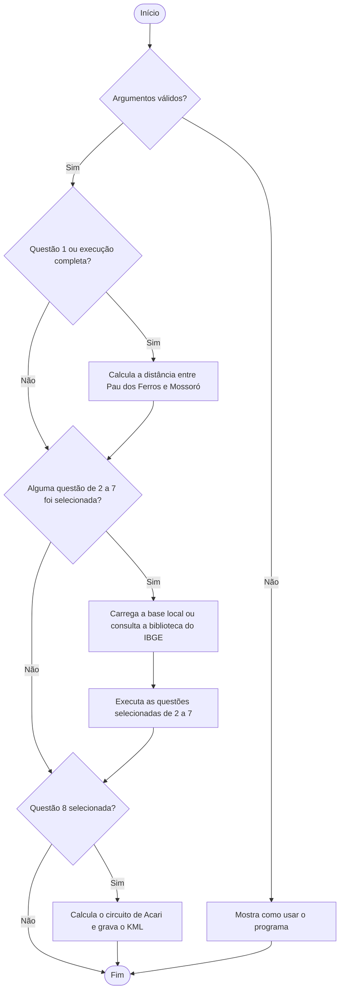
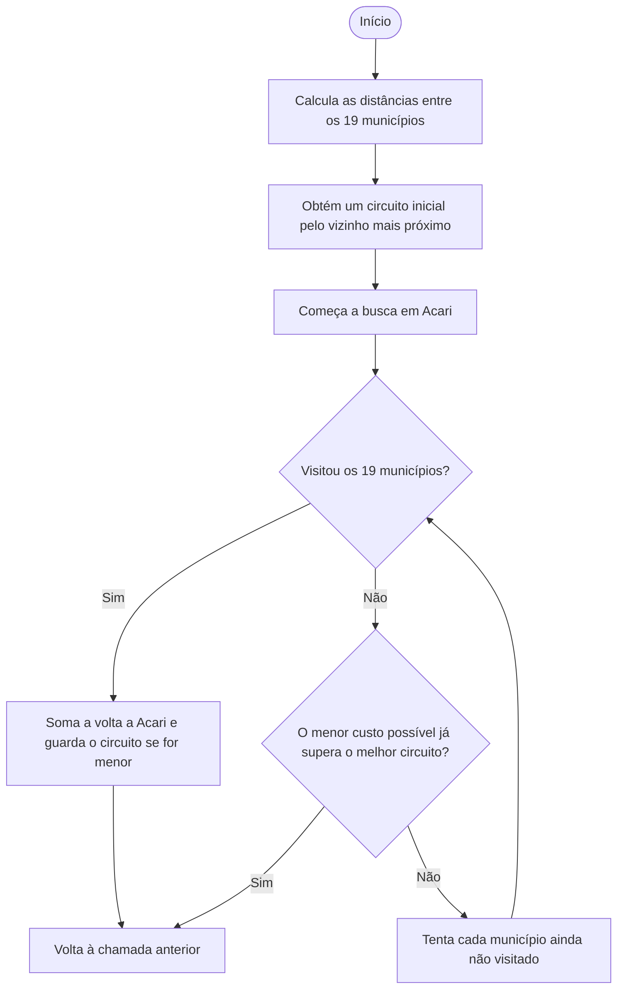
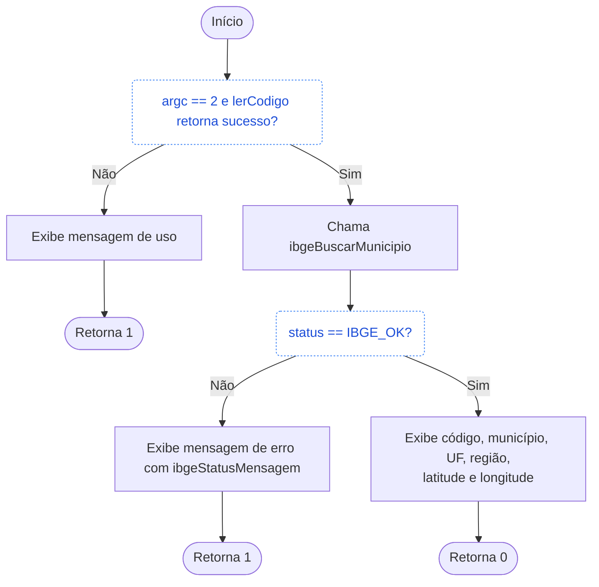
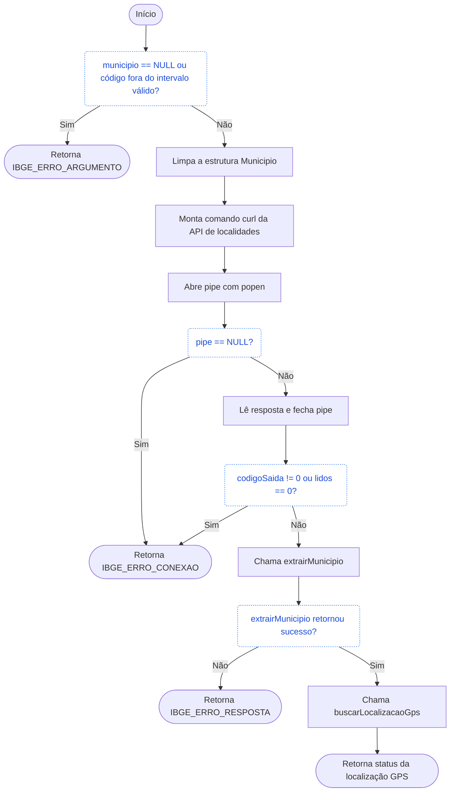
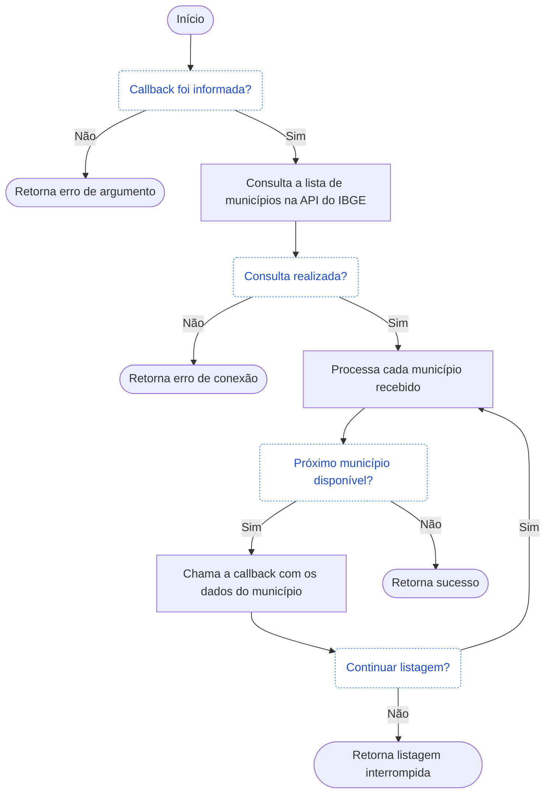
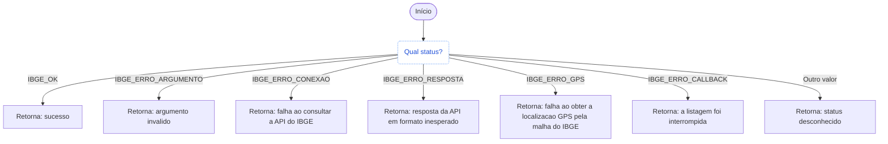

# Fluxogramas da atividade

## Execução do programa

Sem número, o programa executa todas as questões do enunciado. Se faltar um dado necessário ou ocorrer erro de consulta, a execução é interrompida.

## Busca do circuito de Acari

Ao voltar de uma tentativa, a busca desmarca o município para poder usá-lo em outra ordem. O melhor circuito encontrado é usado na saída e no mapa.

## Consulta de exemplo em `exemplos/consultar_municipio.c`

Legenda:

- **Argumentos válidos?**: verifica se foi informado exatamente um argumento e se `lerCodigo` conseguiu convertê-lo em um código válido.
- **Status == IBGE_OK?**: verifica se a consulta ao município foi concluída com sucesso.

## `ibgeBuscarMunicipio`

Legenda:

- **municipio == NULL ou código fora do intervalo válido?**: verifica se os argumentos são inválidos.
- **pipe == NULL?**: verifica se não foi possível iniciar o comando `curl`.
- **codigoSaida != 0 ou lidos == 0?**: verifica se o `curl` falhou ou retornou uma resposta vazia.
- **extrairMunicipio retornou sucesso?**: verifica se a resposta contém os dados do município em formato reconhecido.

## `ibgeListarMunicipios`

Legenda:

- **Callback foi informada?**: verifica se há uma função para receber os municípios listados.
- **Consulta realizada?**: verifica se foi possível obter a lista na API.
- **Próximo município disponível?**: verifica se ainda há municípios para processar.
- **Continuar listagem?**: a callback determina se a listagem continua ou é interrompida.

## `ibgeStatusMensagem`

Legenda:

- **Qual status?**: seleciona a mensagem correspondente ao valor recebido em `status`; valores não reconhecidos produzem a mensagem de status desconhecido.
